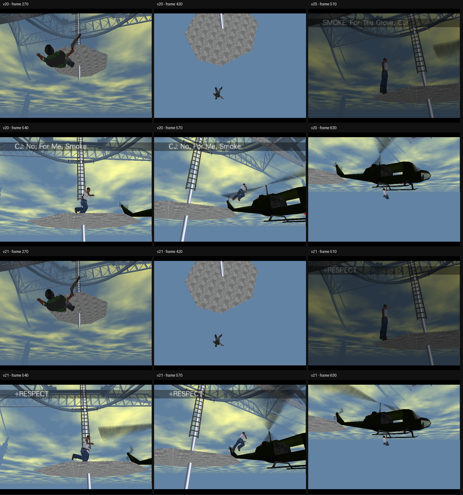

# GoldenEye: GTA Edition — v21 Beta

A playable **GoldenEye 007 (Nintendo 64)** campaign modification that reworks parts of the game with **Grand Theft Auto: San Andreas-inspired characters, dialogue, audio, weapons, presentation and story moments**.

This repository documents the current **v21 beta** and contains the latest incremental source changes and validation material. The beta has been manually played through the campaign **up to Cradle**. **Aztec and Egyptian are currently untested.**

> **Beta status:** playable, but not considered fully stable or complete. See [Known Issues](KNOWN_ISSUES.md) before testing.

## Highlights

- CJ-themed playable-character conversion and **00 CJ** presentation
- GTA-themed character and audio replacements across the campaign
- Custom and modified dialogue sequences in selected scenes
- Custom character voice and hurt-reaction work
- Weapon/model changes, including GTA-inspired weapon work
- Mission-specific script and event changes
- Audio timing and playback changes
- Cutscene and caption sequencing fixes
- Custom Cradle ending presentation, including the `+RESPECT` reward cue
- Facility post-shot dialogue/event timing fix
- Automated focused scene validation plus manual gameplay testing

This is **not** a complete line-for-line dialogue conversion. Some original GoldenEye dialogue remains by design or because that content has not yet been replaced in the beta.

## Current Playability

| Area | Status |
| --- | --- |
| Main campaign through Cradle | **Playable / manually tested** |
| Streets | **Playable with known freeze risk around the Valentin sequence** |
| Facility v21 scene fix | **Focused validation passed** |
| Cradle v21 ending/caption fix | **Focused validation passed** |
| Aztec | **Untested** |
| Egyptian | **Untested** |

For more detail, see [TESTING.md](TESTING.md) and [KNOWN_ISSUES.md](KNOWN_ISSUES.md).

## v21 Focus

The v21 update concentrates on two late-stage scene issues while preserving the rest of the existing beta:

### Cradle

The ending sequence now clears the old upper-dialogue queue before the helicopter reward cue so earlier confrontation captions do not spill into the escape sequence. The existing falling sequence, camera timing and audio behaviour are retained.



### Facility

The post-shot speech logic was adjusted so the intended Tenpenny line can trigger after Smoke is dying/dead even when the original second scripted damage step is skipped. The speech is gated behind the relevant shot event and is designed to play once.

## Technical Work

The project has involved iterative modification and debugging across several GoldenEye systems, including:

- mission setup/script editing
- character and weapon model integration
- first- and third-person weapon presentation
- audio-bank and voice integration
- event-driven dialogue playback
- cutscene/caption sequencing
- timing-sensitive mission logic
- N64 ROM checksum/build handling
- emulator-based regression testing
- focused runtime probes and validation scripts

The included v21 validation report records focused binary and emulator checks for the final Facility and Cradle changes.

## Repository Layout

```text
.
├── README.md
├── CHANGELOG.md
├── KNOWN_ISSUES.md
├── TESTING.md
├── NOTICE.md
├── .gitignore
├── docs/
│   ├── BUILD_NOTES.md
│   └── images/
├── src/
│   └── incremental-v21/
│       ├── build_scene_audio_v21.py
│       ├── scene_missions_v21.py
│       ├── ending_caption_v21.py
│       ├── validate_scene_audio_v21.py
│       └── boot-v6-research/
└── validation/
    └── v21_validation.json
```

## Source Status

The source snapshot in this repository is the **incremental v21 change set**, not the entire historical development tree.

The v21 scripts depend on modules and data from the earlier development source pack, including previous build helpers and the v20 base build. Those dependencies are intentionally documented rather than silently omitted. See [docs/BUILD_NOTES.md](docs/BUILD_NOTES.md).

As a result, cloning this repository alone is **not currently a one-command reproducible build**.

## Installation / Distribution

**No GoldenEye ROM is included in this repository.**

The development ROM (`.z64`) is intentionally excluded from Git tracking. A future public release should be distributed as a patch that requires the user to provide the correct legally obtained base game version.

Do not open an issue asking for a retail ROM.

## Testing

Development has used focused Mupen64Plus runtime tests for specific scene fixes alongside manual gameplay testing in Project64.

The included validation data covers the final v21 Facility and Cradle work. It is **not** a claim that every mission and every state in the campaign has been exhaustively tested.

## Project Status

**Current release:** v21 Beta  
**Campaign status:** manually playable through Cradle  
**Known unstable area:** Streets / Valentin sequence  
**Untested bonus missions:** Aztec and Egyptian

## Fan Project Notice

This is a non-commercial fan modification and portfolio project. GoldenEye 007, Grand Theft Auto: San Andreas, their characters, audio, artwork and other associated intellectual property belong to their respective rights holders.

No retail game ROM is included in this repository.
